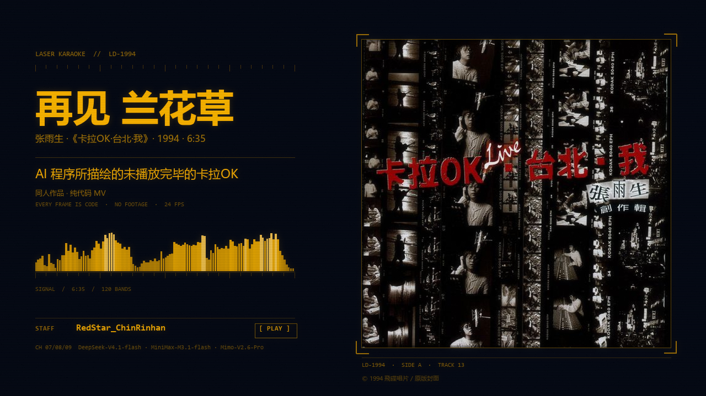

# 张雨生《再见 兰花草》| AI 程序所描绘的未播放完毕的卡拉OK



张雨生《再见 兰花草》（1994，专辑《卡拉OK·台北·我》末曲，6:35）的**代码逐帧生成** TUI 风格同人 MV。
每一帧都是歌曲时间 `t` 的纯函数：一条命令从音频渲染到 mp4，**没有一张素材图**。
非官方同人，不商用 —— 版权与许可见 [NOTICE.md](NOTICE.md)。
代码用 [MIT](LICENSE)（只覆盖代码；歌曲、歌词、专辑封面、模型标识不在此列）。

| | |
|---|---|
| **看片** | **[B 站 BV1fAx36cEMP](https://www.bilibili.com/video/BV1fAx36cEMP/)** |
| 成片 | `out/film-v2.mp4` · 1280×720 / 24 fps / 395.667 s |
| 4K | `python src/build.py 4k` → `out/film_4k.mp4` · 3840×2160（3× 最近邻放大）|
| 封面 | `assets/` 里 16:9 / 4:3 / 1:1 三种比例 |
| 文档 | [plan/INDEX.md](plan/INDEX.md) —— 36 份演进文档的功能地图 |

---

## 快速开始

需要 Python 3.12+、numpy、Pillow，以及 **ffmpeg**：

```bash
pip install numpy pillow
# ffmpeg：放进 tools/（tools/ffmpeg.exe），或者装到 PATH 里 —— 规则见 src/media.py
```

**① 自备歌曲**（不随仓库分发）。把张雨生《再见 兰花草》放到 `input/song.flac`，
必须是 **395.666667 s** 那一版——时间轴、逐字起音、逐句响度全是从这份音频量出来的，
时长差一点，每一句都会错位。详见 [input/README.md](input/README.md)。

**② 出片**（`data/audio/*.npy` 已经在仓库里，所以除了歌曲不需要再准备别的）：

```bash
python src/build.py status      # 七层楼在不在
python src/build.py all         # 盖楼（每层渲完自动重拼主文件）
python src/build.py 4k          # 另出 3840×2160
```

> 楼层 = 篇章：`out/parts/NN-*.mp4` 每层自带音频切片，可以单独看；
> `out/film-v2.mp4` 永远是"已完成的楼层按顺序拼起来"的那一份。
> 盖完楼**必须**用 `ffprobe` 验每层时长——后台任务报 exit 0 但 mp4 坏掉的情况踩过两次。

**③ 改一帧看效果**（不用整片重渲）：

```bash
cd src && python -c "import scene4; scene4.frame(273.5).save('../out/x.png')"
```

---

## 目录结构

```
.
├── README.md / NOTICE.md
├── assets/                封面（16:9 / 16:9-hd / 4:3 / 1:1）
├── input/                 ⚠ 歌曲自备（不进仓库）；album-cover.jpg 是原版封面
├── data/                  时间轴与分析数据（json 进仓库，音频派生文件进 gitignore）
│   ├── timeline.json      段落 + 行级时间，全片唯一时间真源
│   ├── word_times*.json   逐字时间（v2 = 实测 onset）
│   ├── backing_vocal*.json 合唱人数与和声相对电平（原曲 17 轨分轨量出来的）
│   └── audio/             rms / flux / 24 段频谱带 / 四条分轨包络（8 个 .npy，2.0 MB，已进仓库——
│                          渲染必需；只有 wav 与 htdemucs 权重不进）
├── src/                   源码
│   ├── scene4.py          帧函数（纯函数，全片的入口）
│   ├── layout4.py         四区版式与所有画面元素
│   ├── voices.py          实测数据 → 画面参数的桥
│   ├── build.py           盖楼 / 拼主文件 / 出 4K
│   ├── cover.py           封面生成
│   ├── logos.py           三个模型标识的轮廓数据（由官方标识抽出，不是位图）
│   ├── media.py           ffmpeg / ffprobe 在哪
│   └── probes/            一次性调查脚本，不参与出片
├── plan/                  36 份演进文档 + INDEX（先读 INDEX）
├── tools/                 ffmpeg（不进仓库，见 .gitignore）
└── out/                   产物（不进仓库）
```

---

## 它为什么长这样

- **720p 是设计分辨率**。layout4 里所有坐标和字号都是按 1280×720 逐帧调的；
  4K 版是 **3× 整数倍最近邻放大**——画面是"一块 1994 年的屏幕"，像素网格是设计的一部分，
  整数倍放大读起来是"更大的屏"，不是"更糊的图"。
- **画面里没有一处是"估"的**：逐字起音、逐句响度、合唱人数、和声相对电平，
  都是从原曲（以及 17 轨分轨）里量出来的，落到 `data/*.json`，再由 `src/voices.py` 变成画面参数。
- **语法是 1994 年的 TUI**：等宽字、琥珀色、刻度尺、电平条、光标、`> ` 提示符。
  结尾是这台机器自己的关屏。
